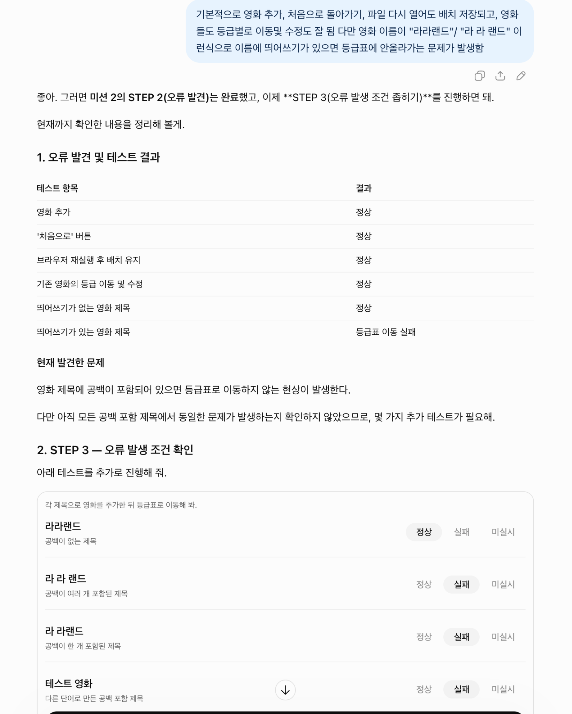

# 미션 2 기록

- **사용한 AI 이름 / 대화 공유 링크 또는 캡처 파일명:** ChatGPT (GPT-6) / 캡처 파일명: `screenshots/AI_대화_오류조건확인.png`
- **좁혀서 적은 한 문장:** 영화 제목에 공백이 하나라도 포함되면 해당 영화 카드를 클릭하거나 드래그해도 등급표로 이동하지 않는다.

## 좁히려고 해 본 것과 결과

먼저 `영화_수정전.html`을 브라우저에서 열고 '처음으로' 버튼을 눌러 초기화했다. 영화 추가, 등급별 이동 및 배치 수정, 초기화, 파일을 다시 열었을 때 배치 유지 여부를 확인했으며, 이 기능들은 정상 작동했다. 그러나 제목에 띄어쓰기가 포함된 영화를 등급표로 옮길 때 실패하는 현상을 발견했다.

오류가 제목의 공백과 관련 있는지 확인하기 위해 다음 영화를 추가해 비교했다.

| 테스트 영화 제목 | 등급 이동 결과 |
|---|---|
| 라라랜드 | 정상 이동 |
| 라 라 랜드 | 이동 실패 |
| 라 라랜드 | 이동 실패 |
| 테스트 영화 | 이동 실패 |

공백이 없는 제목은 정상 이동했고, 공백이 하나 이상 포함된 제목은 이동에 실패했다. 공백이 있는 영화는 **클릭과 드래그 두 방식 모두** 실패했다. 따라서 공백의 개수나 특정 영화 이름보다는 **제목에 공백이 포함되어 있는지**가 오류를 구분하는 조건이라고 판단했다.

## AI가 말한 원인과, 그 설명을 직접 확인한 결과

AI는 원본 HTML의 `card()` 함수에서 버튼을 만들 때 `data-id` 속성값을 따옴표로 감싸지 않은 것이 원인이라고 설명했다. 원본 코드는 다음과 같이 HTML 문자열을 조합했다.

```javascript
template.innerHTML = '<button type="button" class="card" draggable="true" data-id=' + item.id + '>' + item.title + '</button>';
```

예를 들어 제목이 `라 라랜드`라면 `data-id=라 라랜드` 형태가 되어, 브라우저가 공백 앞부분인 `라`만 `data-id` 값으로 인식한다. 그 결과 카드의 식별값과 실제 영화의 식별값이 달라져 이동할 대상을 찾지 못한다는 설명이었다.

설명을 검증하기 위해 브라우저 개발자 도구에서 공백이 포함된 영화 카드의 `data-id`를 확인했다. **전체 제목이 아닌 공백 앞부분만 표시되는 것을 직접 확인**했으며, 해당 카드가 클릭과 드래그 모두에서 이동하지 않는 현상도 재확인했다. 따라서 AI의 원인 설명이 실제 관찰 결과와 일치한다고 판단했다.

## 수정 및 재검증 결과

| 파일명 | 고친 내용 | 다시 해 본 결과 |
|---|---|---|
| `영화_수정1.html` | `card()` 함수에서 HTML 문자열로 버튼을 생성하던 부분을 `document.createElement('button')` 방식으로 변경하고, `element.dataset.id = item.id`로 식별값을 직접 지정했다. 버튼의 제목은 `textContent`로 설정했다. | 아래 7개 항목을 직접 테스트했고 모두 정상 통과했다. |

수정 전 원본 `영화_수정전.html`은 덮어쓰지 않았다. 수정 전후 코드를 비교하여 **카드 생성 부분만 변경**되었음을 확인했다.

### 재검증 체크리스트

- [x] '처음으로' 버튼을 눌러 초기화
- [x] `라 라랜드` 추가 후 클릭으로 S등급 이동
- [x] `라 라 랜드` 추가 후 드래그로 A등급 이동
- [x] `테스트 영화` 추가 후 다른 등급으로 이동
- [x] 공백 없는 기존 영화도 정상 이동
- [x] 파일을 다시 열어 배치 저장 확인
- [x] '처음으로' 버튼으로 초기 상태 복원

**최종 결과:** 공백이 포함된 영화의 이동 오류가 해결되었으며, 기존 영화의 이동, 배치 저장 및 초기화 기능도 정상 작동함을 확인했다.

## (선택) 코랩에서 함께 이야기하고 싶은 내용과 그 이유

겉으로는 영화 카드가 이동하지 않는 문제였지만, 정상 동작하는 제목과 실패하는 제목을 비교하고 개발자 도구에서 `data-id` 값을 확인해 원인을 좁힐 수 있었다. 동료와는 오류를 재현하는 테스트 사례를 어떻게 정하고, AI의 원인 설명을 실제 브라우저에서 어떻게 검증할 수 있는지 이야기하고 싶다.

## AI 대화 증빙

오류 발생 조건을 좁히기 위해 진행한 AI 대화 화면이다.


